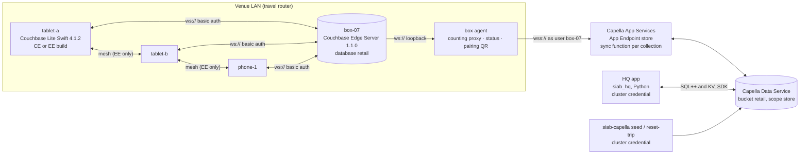
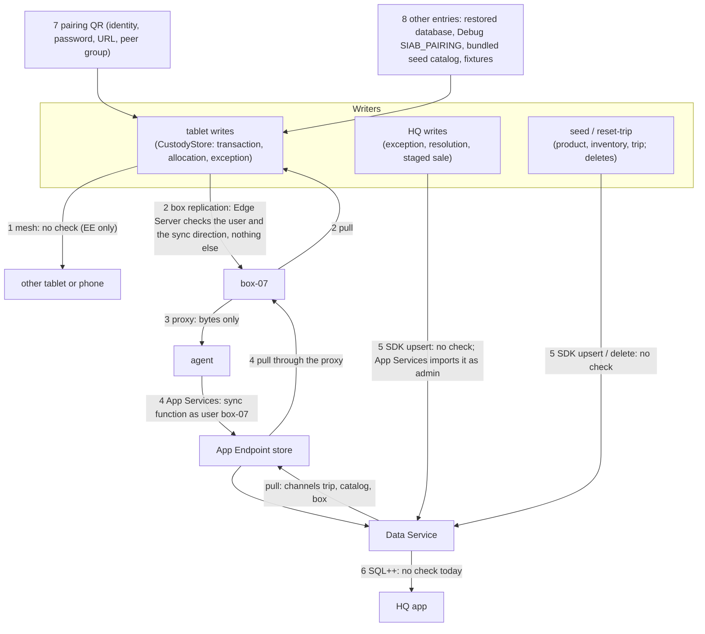

# Servers and the sync trust map: who checks what, on which path

Store in a Box moves documents between four kinds of node (tablets, the box, App Services, HQ) over seven paths,
and two of those nodes run the custody ledger in two languages. This note is the map of what each component
enforces, which paths are checked by whom, where a document can enter a node unchecked, and what the ledger does
about it. It exists because issue #96 showed that a schema-invalid document can reach a tablet without ever passing
the App Services sync function, and decision [010](../decisions/010-reduce-only-valid-documents-log-every-drop.md)
ruled that a node reduces only schema-valid documents, drops the rest, and logs every drop. The implementation is
blueprint [WS10](../workstreams/WS10-ingest-validation.md).

Audience: the owner before the live verification session, and an engineer who must know which guarantees are real.
Three kinds of statement are kept apart throughout, and each claim says which it is:

- **Vendor docs**: fetched from docs.couchbase.com on 2026-10-13, with the URL. A product claim without a URL is
  marked *unconfirmed*.
- **Observed in this repo**: in code, config or tests, with the file and line.
- **Never run live**: nothing in this repository has yet run against a real Edge Server, App Services endpoint or
  Capella cluster. Every live behaviour is an open `needs-verification` issue, and section 8 lists them.

## 1. The components, as pinned here

| Component | Version pinned here | Runs | Enforces | Does not enforce |
|---|---|---|---|---|
| **Couchbase Lite Swift** | 4.1.2, exact (`app/SIABCore/Package.swift:23`), Community Edition by default, Enterprise Edition when `SIAB_CBL_EDITION=enterprise` | each iPad and the iPhone | the typed decode of the documents the app reads (`CustodyStore.load`, `CustodyStore.swift:311`); the reducer's own rules (rule 3's `resolution.by == hq` in `Ledger.swift:88`); basic auth and an optional pinned certificate towards the box (`Replication.swift:24`) | any schema check on what replication writes into its collections; who may write `product` or `trip` locally; which peer may join the mesh beyond "presents any certificate" (`Replication.swift:34`) |
| **Device-to-device sync** (the `MultipeerReplicator` mesh) | part of Couchbase Lite 4.1.2 Enterprise Edition only: the mesh compiles only under `COUCHBASE_ENTERPRISE` (`Package.swift:27`, `SyncCoordinator.swift:255`); a Community build reports `mesh: unavailable` | between the three devices, Wi-Fi and Bluetooth LE | TLS between peers with certificate authentication (vendor docs: "`MultipeerReplicator` only supports certificate based authentication", [Multipeer P2P Replicator](https://docs.couchbase.com/couchbase-lite/current/swift/p2psync-multipeer.html), checked 2026-10-13) | nothing about document content; the demo's authenticator accepts any peer with a certificate (`Replication.swift:34`, "Phase 0: any peer presenting a certificate; Phase 1 pins the box-vended CA") |
| **Couchbase Edge Server** | 1.1.0 (`box/install/install.sh:8`), macOS laptop | the box | basic auth from a bcrypt users file (vendor docs: "Store passwords as bcrypt hashes", [Authentication](https://docs.couchbase.com/couchbase-edge-server/current/configuration/authentication.html)); per-database sync direction `enable_client_sync` (`"pull"` is read-only, `"push"` write-only, `"bidirectional"` both: [config schema](https://packages.couchbase.com/couchbase-edge-server/config_schema.json)); which collections and channels it replicates up (`box/edge-server/config.json.tmpl`) | per-collection privileges in 1.1.0 (#50; `box/README.md`, "No per-collection privileges"); any sync function, schema check or conflict hook (decision 001; the config schema has no such keys). **Newer than the box:** Edge Server **1.1.1 (October 2026)** is the latest release, and its release notes list CBL-8556, "Support `enable_user_access_control` per database" ([release notes](https://docs.couchbase.com/couchbase-edge-server/current/product-notes/release-notes.html), checked 2026-10-13). The [Configure Access Control](https://docs.couchbase.com/couchbase-edge-server/current/access-control/configure-access-control.html) page describes the setting with per-keyspace `read`/`write` grants in the users file, and says that when it is unset "all configured users have unrestricted read and write access to all collections in all databases". **Unconfirmed:** that page's version prerequisite is an unfilled placeholder and the release note says "per database", so which release first ships per-collection grants is not documented. Not pinned, not run here; see section 9. |
| **The box agent** (`src/siab_box/`) | this repo | beside Edge Server | nothing about documents: it relays bytes (`proxy.py`), counts them, serves status and the pairing QR. It is the only path the box's replication to App Services takes (`config.json.tmpl`, `target: ws://127.0.0.1:<proxy>`) | authentication on its own API (`ports/box-agent.md`: "plain HTTP, no authentication: it is meant for the venue LAN only"); the pairing page carries the device password |
| **Capella App Services** | not pinned: the endpoint's runtime is whatever Capella runs; the repo pins only the sync functions (`sync/functions/`) and the users (`sync/app-endpoint.json`) | Capella | the Access Control and Data Validation function on "every document write to the associated linked collection" ([App Services docs](https://docs.couchbase.com/cloud/app-services/deployment/access-control-data-validation.html)): type, trip and box present, writer is the box or `hq`, channel access, immutability of transactions, HQ-only resolution (`sync/functions/*.js`, the fixtures in `contracts/fixtures/sync/`); app users and channels | the document's schema (the function checks a handful of fields, never the whole shape); writes that arrive by import from the Data Service rather than from a client (section 2, path 5); a `requireAccess` grant made through the `*` wildcard (vendor docs: "`requireAccess()` will only recognize grants made explicitly using a channel name (not by a wildcard)", [Sync Gateway sync function](https://docs.couchbase.com/sync-gateway/current/access-control/sync-function/sync-function.html); the test harness assumes the opposite, `sync/tests/harness.mjs:44`) |
| **Capella Data Service** | not pinned | Capella | the cluster credential (`CAPELLA_DB_USERNAME`) with read and write on `retail`, query rights | nothing about content: an SDK `upsert` writes any JSON (`src/siab_capella/live.py`), and App Services imports it afterwards |
| **The HQ app** (`src/siab_hq/`) | this repo | the presenter's laptop, loopback only | the request shape of its own API (`server.py:check_request`); the price shape of the staged sale (`reconcile.py:373`); the reducer's rules, through the Python reference | the schema of what it reads back from the Data Service (today `reduce` takes the raw rows, `reconcile.py:248`); it writes with the cluster credential, so neither App Services' writer check nor its `only hq may resolve` rule gates it (#93) |
| **The Python reference ledger** (`src/siab_ledger/`) | this repo | HQ (imported) and the fixture runner | rules 1 to 8 over documents it assumes schema-valid; today a missing field raises `KeyError` (`chain.py:85`, #96 case 3) | any schema check (WS10 adds the pre-filter) |

Two more version facts matter for Stage A. Couchbase Lite Swift 4.1.2 is the latest release on the vendor's page
(September 2026; 4.1.0 added Bluetooth LE to the Multipeer Replicator, and 4.1.2 fixed two replicator crashes,
CBL-8735 and CBL-8813; the one open known issue for 4.1.x is "MultipeerReplicator peer-info methods may block when
using Bluetooth", CBL-8574; [release notes](https://docs.couchbase.com/couchbase-lite/current/swift/releasenotes.html),
checked 2026-10-13). And `SyncCoordinator.commonName` calls `peerInfo(for:)` to name each peer
(`SyncCoordinator.swift:289`), which is the method that issue names. Database encryption is an Enterprise Edition
feature ([Database](https://docs.couchbase.com/couchbase-lite/current/swift/database.html)); delta sync is marked
Enterprise on the Couchbase Lite side ([Replication](https://docs.couchbase.com/couchbase-lite/current/swift/replication.html))
and is a per-endpoint setting on App Services ([Delta Sync](https://docs.couchbase.com/app-services/app-endpoints/delta-sync.html)).
Whether the vendor documents the Multipeer Replicator as Enterprise-only could not be confirmed from the product page
(it does not say); what is observed is that the Community package does not ship it, which is why the mesh is behind a
compile condition. Edge Server 1.1 supports macOS 13 or later (Intel and ARM64), Ubuntu 22.04 or later on x86_64 and
ARM64, Debian 11 or later on x86_64 only, Fedora 40, and Windows for development
([Supported Platforms](https://docs.couchbase.com/couchbase-edge-server/current/product-notes/supported-platforms.html)),
which is why the Raspberry Pi on Debian ARM64 is best-effort (decision 002, #47).

## 2. Every path a document takes

| # | Path | Who can write | Checked on the way in, by what | Not checked |
|---|---|---|---|---|
| 1 | **Tablet to tablet** (the mesh; Enterprise only) | any device holding a certificate and the peer group id `siab-<trip>` (`PairingPayload.peerGroup`, printed on the LAN pairing page) | TLS with a certificate presented (`Replication.swift:34` accepts any); Couchbase Lite replicates the five `store` collections whole (`Replication.swift:42`) | schema, writer, trip, collection: nothing. This is the path #96 names: a peer's `product` or `trip`, an edited exception, a future `kind`, all land in the other device's collections unexamined. |
| 2 | **Tablet to box and back** (Edge Server REST replication over `ws://`, basic auth, the pinned certificate only when `EDGE_TLS=on`) | the three device users in the users file (`render_config.py:users`); any of them may write any of the five collections (`enable_client_sync: "bidirectional"`, `config.json.tmpl:10`; no `access` grants, 1.1.0) | the user's password; the database's sync direction | schema, type, writer, trip, collection (#50). A device can write `product` and `trip` on the box, and the box keeps it. |
| 3 | **Box to the agent's proxy** | Edge Server's replicator, loopback only | nothing: the proxy rewrites the `Host` header and relays (`proxy.py:84`) | everything; by design, it counts bytes |
| 4 | **Box to App Services** (`wss://`, user `box-07`) | the box user, holding `trip:<trip>`, `catalog:<region>`, `box:box-07` | the sync function of the collection, as user `box-07`: `type`, `trip`, `box`, writer in `[doc.box, "hq"]`, `requireAccess("trip:"+doc.trip)`, immutability, `only hq may resolve` (`sync/functions/`); what the box may *pull* is its channels | the document's schema beyond those fields; a document that fails is rejected with 403 ("rejected with an HTTP 403 Forbidden error code", [Sync Gateway sync function](https://docs.couchbase.com/sync-gateway/current/access-control/sync-function/sync-function.html)) and stays on the box. What Edge Server then does with that document (retry forever, skip, stall the task) is **unconfirmed** (#50 assumes "the box's push would keep failing on that document"). |
| 5 | **HQ, the reconciler, seed and reset-trip to the Data Service** (SDK, cluster credential) | anyone with `CAPELLA_DB_USERNAME` | nothing on the way in. App Services then *imports* the write. Per the Sync Gateway docs the import "is processed with an admin user context in the Sync Function", "`requireAccess`, `requireUser` and `requireRole` calls in the Sync Function are treated as no-ops" and "`oldDoc` is `nil`" ([shared bucket access](https://docs.couchbase.com/sync-gateway/current/shared-bucket-access.html)); App Services' own pages say only that the function runs "on every document write to the associated linked collection" and that an import filter is "for a coarse-grained filter only" ([Import Filters](https://docs.couchbase.com/app-services/app-endpoints/import-filters.html)). So for an SDK write: the writer checks pass, the update rules (`immutable`, `only status and resolution may change`) never run because `oldDoc` is null, and only `type mismatch`, `trip is required` and the routing remain. **The sync harness mirrors this** (`sync/tests/harness.mjs:41-55`, `rules.test.mjs:30`). | the schema; whether a rejected import stays in the bucket unrouted (unconfirmed, section 8). HQ reads the bucket directly (path 6), so a document the import rejected is still HQ's input. |
| 6 | **Data Service to HQ** (SQL++, `queries.py:407-411`) | n/a (a read) | nothing today: `reduce` takes the rows as they are (`reconcile.py:248`) | the schema. WS10 adds the pre-filter here. |
| 7 | **The pairing QR** (`/pair/<device>`, LAN, plain HTTP) | the box agent produces it; anyone on the LAN can read it | `PairingPayload.decode` refuses an unknown `v` and malformed `device`, `box`, `trip`, `edge_url`, `cert_sha256` (`Pairing.swift:30-52`, after #104 and #108); `PairingStore.load` validates again on every launch (`PairingStore.swift:98`) | that the device id in the payload is unique on the trip (two tablets scanning one QR become one writer, #77 E2); that the payload came from this box (no signature; `cert_sha256` pins the box only when TLS is on); the password crosses the LAN in clear (`box/README.md`, "TLS on the LAN: off for Phase 0") |
| 8 | **Other entries** | | | |
| 8a | a restored or copied Couchbase Lite database (`storeinabox` on a device, `retail.cblite2` on the box) | whoever holds the file | nothing | the restored movements re-enter the ledger and, if the trip was reset meanwhile, come back to Capella: an update over a tombstone is accepted as a create (`rules.test.mjs:35`) |
| 8b | the Debug launch hook `SIAB_PAIRING` (`AppModel.swift:37`) | whoever launches the simulator | the same `decode` as the QR | it is a Debug build only |
| 8c | the bundled seed catalog `seed-products.json` (`Catalog.swift:12`) | the repository | `check_contracts.py` in CI (it is a link to `contracts/fixtures/seed/products.json`) | nothing at runtime; it is read with `try?` (`Catalog.swift:65`) |
| 8d | `siab-capella seed` (`seed.py:load_seed`) | the cluster credential | `check_contracts.py` in CI checks the fixtures; `seed --diff` shows live-versus-fixture | nothing at runtime: a locally edited fixture file is written as-is |
| 8e | the ledger fixtures, as input to the fixture runners and to `SIAB_HQ_FAKE` | the foreman | `check_contracts.py` validates every document | after WS10, a fixture may carry documents marked `_invalid` on purpose |

The one path that *is* checked for anything beyond a password is path 4, and only for documents the box pushes. Every
other path admits any JSON object into a collection. That is the fact the rest of this note is about.

## 3. The trust matrix

What can enter each node type unchecked, by which path, what reads it next, and what happens today. "Invalid" means a
document that fails its collection schema in `contracts/schemas/store/`; "unauthorised" means a document the sync
function would refuse (a tablet writing `product`, a non-hq resolution, another box's trip).

| Node | Collection | Can an invalid or unauthorised document enter? | What reads it next | What happens today | Guard, and how real it is |
|---|---|---|---|---|---|
| **Tablet** | `transaction` | yes: paths 1, 2, 8a. A peer or the box delivers anything. | `CustodyStore.rebuild` → `all()` → `Ledger.reduce` on every change (`CustodyStore.swift:205`) | an undecodable body is skipped by `try?` (`CustodyStore.swift:307`): the movement vanishes, no count, no log, the row can still say `holds` (#104 item 4). A decodable body with a wrong value the typed model accepts (an `hlc` that does not match the pattern, a `sku` not matching `unit_id`, an extra field) is reduced as if valid, and the Swift and Python results can differ (#96). | convention: every writer is this app, which writes schema-valid documents (its fixture tests say so). No node checks. |
| Tablet | `exception` | yes, same paths | the reducer's rule 3 (`Ledger.hqResolutions`), `ExceptionsViewModel` | a resolution with `status: resolved` and `resolution.by: "hq"` from *any* peer counts (rule 3 checks fields, not provenance). A forged resolution is schema-valid; ingest validation does not catch it. It never reaches Capella (the box's push would fail `only hq may resolve`), so the venue and HQ disagree on the dispute. | convention plus the sync function one hop up. The reducer trusts `resolution.by`. |
| Tablet | `allocation` | yes | `CustodyStore.activeAllocation` (`CustodyStore.swift:255`), the Custody screen | an undecodable allocation is skipped; a decodable one with a wrong `custodian` can make a take open a second allocation | convention |
| Tablet | `product`, `trip` | yes: a peer or the box can deliver a tablet-written product (#50) | `StoreProductCatalog` (`Catalog.swift`), `try?` skip | a bad product is skipped silently; a wrong price in a decodable one is shown and sold at | convention: the app never writes these (WS6 tests); nothing enforces it on the mesh or the box |
| **Box** (Edge Server 1.1.0) | all five | yes: path 2, any device user, any collection; path 4 pull delivers what App Services routes | nothing on the box reads content; it replicates | an unauthorised document (tablet-written `product`) is kept and pushed; App Services refuses it; the document stays on the box and reaches every other tablet (path 2 pull) | none on 1.1.0. Edge Server 1.1.1's `enable_user_access_control` could make `product` and `trip` read-only for device users (section 9, Q3). |
| **App Services** | `transaction`, `allocation`, `exception` | from the box: only what the function admits (type, trip, box, writer, access, immutability, HQ-only resolution). From an import (path 5): anything with the right `type` and a `trip`. | the Data Service, the box's pull, HQ's reads | a schema-invalid transaction with `type: "transaction"`, `trip` and `box` set is admitted from the box and routed to the venue; an import never meets the writer or update rules | the sync function, for the fields it names, on the box path only |
| App Services | `product`, `trip` | from the box: refused (`writer must be hq`). From an import: admitted. | the box's pull | a seed document is trusted because `check_contracts.py` checked the fixture, not because anything checked the write | the sync function on the box path; CI on the fixtures |
| App Services | `inventory` | never linked (`app_services.py:14`, `NEVER_LINKED`) | HQ only | | design: on-hand never reaches a venue |
| **HQ** | `transaction`, `exception`, `allocation`, `inventory`, `trip` | yes: path 5 from anyone with the cluster credential, including HQ's own bugs and a hand edit in the Capella UI; and everything the box pushed (which the function admitted) | `queries.load` → `reduce` (`reconcile.py:245`) | a missing required field raises `KeyError` inside `reduce` and the whole reconcile fails (`run_every` records `last_error`; the screen keeps the last snapshot). A resolution missing `at` or `note` still counts (`chain.py:118`, `.get`). | none today. The sync function does not gate HQ's reads, because HQ reads the bucket, not the endpoint. |

What is guarded only by convention, plainly: (1) that a tablet never writes `product` or `trip`; (2) that a
resolution with `resolution.by: "hq"` was written by HQ; (3) that every transaction on a tablet was written by this
app and not by a peer running something else; (4) that nobody edits a document in the Capella UI; (5) that the
pairing QR was scanned by one device. Items 2 to 5 are not changed by WS10. Item 1 is changed by Edge Server 1.1.1 if
adopted (Q3).

## 4. The edge cases the owner would not want to learn on stage

Each: how it arises, reachable in the demo, what the code does today, the consequence, the guard, the gap, and the
recommendation. "Reachable" means it can happen in the Phase 0 runbook without anyone trying to break anything.

**E1. A transaction missing a required field (#96 case 3).** Arises when a device on a newer app writes a field the
older schema does not have, or an older one omits a field the newer schema requires; or a hand edit in the Capella UI.
Reachable: only by a mixed-version rehearsal, which the free Apple account's seven-day installs make plausible.
Today: Swift skips it (`CustodyStore.swift:307`), Python raises `KeyError` (`chain.py:85`: `txn["prev_txn"]`), so
HQ's reconcile loop fails every 3 s and `last_error` fills while the screen shows a stale snapshot. Consequence: the
tablet shows a count one short and `holds`; HQ shows nothing new. Guard: none. Gap: silent on one side, loud on
the other. Recommendation: decision 010, WS10: both drop it, both count it, HQ's loop keeps running.

**E2. A resolution missing `at`, `note` or `by` (#96 case 2).** Arises as E1, on an exception document edited by hand
or by a newer HQ. Reachable: only by editing. Today: Swift cannot decode it and ignores it; Python counts it when
`status == resolved` and `resolution.by == hq` (`chain.py:117-121`). Consequence: HQ shows the fork settled and the
unit held; the tablet shows it disputed. Guard: none. Recommendation: WS10 drops it on both sides (`missing_field`),
fixture `drop-resolution-missing-field`.

**E3. Same id, two bodies, one with an extra field (#96 case 1).** Arises when a document is edited after it was
written (which the sync function forbids on the box path but nothing forbids on the mesh or by import) and both bodies
are delivered. Reachable: a Capella UI edit of a transaction; two installs sharing a device id (E8). Today: rule 5's
tie-break keeps the body with the smaller canonical JSON; Swift canonicalises the typed model (extra field dropped),
Python the raw dict (`chain.py:79-86`), so they can keep different bodies. Consequence: the two reducers disagree on
`prev_txn` or `to_custodian` of one movement. Recommendation: WS10 validates before dedupe; the body with the extra
field is dropped (`extra_field`) and the tie-break only ever compares valid bodies. Fixture `drop-extra-field-same-id`.

**E4. The `try?` skip in `CustodyStore.all()` (#104 item 4).** Arises on any undecodable body: a future `kind`, a
`v: 2`, a non-integer `cents`. Reachable: a newer app on one device. Today: the row disappears from the ledger and
from Diagnostics; the "Movements" count is one short and nothing says so. `StoreProductCatalog.stored()` does the
same for products (`Catalog.swift:65`). Consequence: a sale vanishes from the Shelf; the conservation row the owner
would compute from the tablet says `holds`. Recommendation: WS10 replaces the skip with a drop record, counted and
shown in Diagnostics; the catalog's skip is logged the same way (products are not reduced, so they are not counted
beside conservation).

**E5. A tablet writes `product` or `trip`; the box keeps it and cannot push it (#50).** Arises from a bug or a
different app build. Reachable: not by the Phase 0 app (it never writes those collections). Today: Edge Server
1.1.0 accepts it (`enable_client_sync: bidirectional`, no per-collection access), every other tablet pulls it, App
Services refuses the push (`writer must be hq`), and what the Edge Server replicator does with a document App
Services refuses is unconfirmed (retry each cycle, or skip). Consequence: a wrong price on every tablet for the rest
of the day; possibly a replication task that never reaches `idle`, which the status page shows as `busy` or `error`.
Guard: the sync function, one hop up; convention on the app. Gap: the box. Recommendation: Q3, Edge Server 1.1.1
with `access` grants: devices `read` on `product` and `trip`, `read` and `write` on the other three; verified
live before it is relied on. Until then, a Couchbase Lite pull filter on `product` and `trip` for the box
replicator that accepts only documents whose `_id` the seed could have produced is a cheap partial guard ("an
important security mechanism in a peer-to-peer topology with peers that are not fully trusted", [Replication](https://docs.couchbase.com/couchbase-lite/current/swift/replication.html)); not in WS10's scope.

**E6. HQ writes as the cluster credential, so `only hq may resolve` never gates it (#93).** Arises by design.
Reachable: every HQ write. Today: `gw.upsert` (`reconcile.py:262`, `:301`, `:386`); App Services imports the write
in the admin context with `oldDoc` null, so the function sees a create by an admin and routes it. Consequence: the
`hq` app user and `HQ_APP_*` are unused; nothing checks that HQ's exception documents or the staged sale are
schema-valid except HQ's own code and the fixtures `exceptions_for` is checked against; a bug in HQ writes straight
into every tablet's ledger. Guard: `exceptions_for` is fixture-checked; the staged sale's price is shape-checked.
Gap: no check on the write, and a rejected import's fate is unconfirmed. Recommendation: accept (a) of #93 for Phase
0, and have WS10's HQ side validate every document HQ is about to write against its schema before `upsert` (the same
pre-filter, in the other direction), so HQ never writes what a tablet would drop. Verify the rejected-import
behaviour live (section 8).

**E7. A peer on a different contract version or schema.** Arises when one device is reinstalled from a newer or
older branch. Reachable: yes, during rehearsals. Today: documents with a field more or less are E1 to E4, and
nothing checks `v` on either side: the Swift model decodes `v: 2` (`Models.swift:39`, a `var` with a default) and
reduces the body, and Python never reads `v`. Consequence: silent divergence until a field changes. Recommendation: WS10's `version`
code, checked first, worded in Diagnostics as "newer schema (v2): update the app". A contract bump of `v` is the
decision's own revisit trigger.

**E8. A malformed or replayed pairing payload.** Malformed: refused since #104 and #108 (`Pairing.swift:37-52`).
Replayed, the real risk: the QR carries the device id and password, and two devices that scan `/pair/tablet-a`
both become `tablet-a`. Reachable: an operator error at pre-flight step 6. Today: both write HLCs as `tablet-a`;
`txn::<hlc>` ids collide when both write in the same millisecond with counter 0, and rule 5 then silently keeps
one body and discards the other movement on every node (`chain.py:79`, `Ledger.swift:75`). Their allocations open
twice. Consequence: a lost sale with no exception. Guard: none (the pairing page is a static GET). Gap: the
agent cannot see a second scan. Recommendation: a runbook line (pre-flight: Diagnostics on each device shows a
different device id), and in Phase 2 the device close exposes it (`inconsistent`, #81). Not WS10's.

**E9. Clock skew and HLC ordering across devices.** Arises when one iPad's clock is wrong (SPEC section 8, item 11,
says the demo will do this on purpose later). Today: `hlc_receive` takes the greatest of local, remote and the clock
(`hlc.py`, `HLC.swift`), and `CustodyStore.observe` merges every pulled HLC (`CustodyStore.swift:228`), so a device a
day ahead drags every other device's and HQ's HLC a day forward for good (counters carry, nothing ever comes back
down); the `oldest unpushed 14:02` line and `device_clock` labels go wrong, the `txn::` ids sort as if written
tomorrow, and the leaf rule (greatest `hlc` wins, rule 4) prefers that device's movements over a concurrent one's.
Decision 005 names the two accepted skew cases (a blind take by a slow clock loses the leaf race or forks falsely).
Consequence: ordering stays causal, so no unit is lost or doubled; a false `double_scan` is possible; times on
screen are wrong. Guard: none. Gap: an HLC bound. Recommendation: Phase 1 (clock skew is scheduled there); until
then a pre-flight check that the three devices and the laptop agree to the minute. Q5.

**E10. Tombstones and purge across tiers (#41).** `reset-trip` deletes through the SDK; App Services imports the
delete (admin context, `oldDoc` null, so the function's delete branch routes on `oldDoc.trip` which is... null:
`store.transaction.js:9` does `if (oldDoc && oldDoc.trip) channel(...)`, so an imported tombstone with `oldDoc`
null is routed **nowhere**). If the vendor statement "`oldDoc` is `nil` when the Sync Function is executed" applies
to imported deletes, the tombstone never reaches the box and the reset silently does not reset the venue. This is
exactly what #41 is written to observe ("an imported delete may arrive with `oldDoc` null"). Further: a tablet that
is off during the reset keeps the old trip's movements and pushes them back afterwards, and an update over a tombstone
is a create (`rules.test.mjs:35`): last rehearsal's sales reappear in this rehearsal's ledger. The server purges
tombstones after the metadata purge interval, 3 days by default, after which "that tombstone is no longer replicated
to mobile clients" ([Tombstones](https://docs.couchbase.com/sync-gateway/current/manage/managing-tombstones.html)),
so a tablet left in a drawer for a week never learns of the reset at all. Consequence: a stale device re-populates
the ledger on stage. Guard: `reset.md` resets the tablets too (#126 verifies). Gap: a device that misses the reset.
Recommendation: verify #41 first (it may show the delete branch needs `meta` or the document's own `trip` from
`oldDoc` being absent); make the runbook's reset step refuse to finish while any device in `trip.devices` is not
seen; and in Phase 2 the device close detects a resurrected movement (`extra`, #81).

**E11. The Community default build on stage.** `SIAB_CBL_EDITION` defaults to `community`, which builds and syncs
with the box but has no mesh (`mesh: unavailable (Community Edition)` in Diagnostics, `no mesh` in the status
bar). Reachable: a rebuild the morning of the demo without the environment variable. Consequence: beat 3 (the box
goes dark) and beat 4's out-of-range selling degrade to "nothing syncs until the box is back"; counts still hold,
so nobody notices until the box is powered off. Guard: Diagnostics shows the edition; the runbook's pre-flight step
6 says to check. Gap: the status bar's `no mesh` is small. Recommendation: the pre-flight checklist names the
Diagnostics line `Couchbase Lite: Enterprise Edition` as a pass condition (WS7 follow-up); CI already builds both.

**E12. The app and the Python reference disagreeing on the same data.** Arises on any input outside the fixtures.
Today: 39 fixtures, each shuffled by both runners with different random orders; the only known divergences are the
three in #96, all on invalid input. Residual risks after WS10: the two validators disagreeing on *what* is invalid
(a float where an integer is required decodes to nothing in Swift's `JSONValue`, which has no double case,
`JSONValue.swift:5`, so Swift would call the whole body `malformed` where Python says `invalid_value`), and the error
*code* each reports. Recommendation: the differential test in section 7, with a corruption generator that includes
the float case, and `JSONValue` gaining a number case so Swift validates values rather than failing to parse them.

**E13. A forged or stray resolution at the venue.** Arises when any node writes an exception document with
`status: resolved` and `resolution.by: "hq"`: a bug, a replayed older HQ document, or a peer. Reachable: not by the
Phase 0 app. Today: the reducer counts it (rule 3 checks fields); the sync function refuses it when the box pushes it,
so it stays at the venue. Consequence: the venue settles a dispute HQ has not. Guard: the sync function, one hop up.
Gap: the mesh and the box. Recommendation: none for Phase 0 beyond stating it; Phase 1's signed documents
(conflict-free-ledger.md, possible enhancements) is the real fix.

**E14. The `*` wildcard and `requireAccess` on the real runtime.** The `hq` app user holds `["*"]`
(`app-endpoint.json`), and the harness treats `*` as every channel (`harness.mjs:44`), so `allocation-by-hq-ok`
and `transaction-by-hq-null-box-ok` pass in `node --test`. The Sync Gateway docs say `requireAccess()` recognises
only explicit channel names. Today HQ never writes through the endpoint, so nothing observes it. Consequence if
HQ ever does (#93 option b): every HQ write is refused with `access`. Recommendation: observe it in Stage A (section
8) before option (b) is ever chosen.

**E15. An imported document the sync function rejects.** A `transaction` written by SDK with `type: "product"`, or
with no `trip`: the import runs the function, which throws. What App Services does then (leaves the document in the
bucket unrouted; marks it; logs it) is unconfirmed. HQ reads the bucket by SQL++ regardless, so HQ reduces what the
endpoint refused. Recommendation: WS10's pre-filter at HQ (path 6) and the HQ-side write check (E6); observe the
import rejection live (section 8).

**E16. The agent's API and the pairing page are open on the LAN.** Anyone on the travel router's network can cut the
uplink (`POST /uplink/cut`) or read a device password. Reachable: a venue guest on the Wi-Fi. By design for Phase 0
(`ports/box-agent.md`). Not WS10's; noted because the owner asked for everything.

## 5. The drop record and conservation

### 5.1 The record

Two layers, because the reducer is pure and a node is not.

**`Drop`**, what the pre-filter returns (pure, deterministic, the same in Python and Swift, compared by the fixtures):

| Field | Type | Meaning |
|---|---|---|
| `id` | string | the document id (`_id` in fixtures, the Couchbase Lite document id on a device, `META().id` at HQ) |
| `collection` | `transaction` or `exception` (the two the reducer ingests; `allocation`, `product` and `trip` use the same record for logging only) | |
| `code` | one of `malformed`, `wrong_type`, `version`, `missing_field`, `extra_field`, `invalid_value`, `rule` | why, as a small fixed vocabulary both validators can derive (the mapping is in WS10, Interfaces) |
| `detail` | string | the first failing check in words (`device_clock: required`, `kind: 'transfer' is not one of ...`). Free text; never compared by a fixture. |

One `Drop` per `(collection, id)`: when several invalid bodies share an id (E3 with two edits) the record carries the
smallest code in the order above. A valid body under the same id is reduced; the drop record still names the id.

**The drop log entry**, what a node keeps (node-level, has a clock):

| Field | Meaning |
|---|---|
| the `Drop` fields | |
| `source` | where the node got the document, when it knows: `local` (the id's HLC names this device), `box` (the box replicator's document listener reported it pulled), `peer` (neither; inferred, so marked as such), `capella` (HQ), `fixture` (the fake and the runners) |
| `first_seen`, `last_seen` | RFC 3339, the node's clock; a drop re-seen on every rebuild updates `last_seen` only |

**Where it lives: local only.** On the tablet, in `local.drop_log`, one document per `(collection, id)`, in the
never-replicated `local` scope beside `unit_state` and `device` (`CustodyStore.localCollections`). At HQ, in process
memory on `Hq.status`, like `exceptions_written`. Not replicated, and no new `store.*` collection, for four reasons:
a drop is one node's opinion relative to *its* schema version (an older node would publish drops of valid documents,
and a newer node would reject the drop documents themselves); a replicated drop log fans out as nodes × bad documents
and needs a sync function, a channel and a purge rule of its own; the `trip:` channel would carry drop documents to
every tablet, which has nothing to do with them; and Phase 2's device close is the right carrier for "what I could
not read" if HQ ever needs it (a `drops` count in the manifest, #81; not designed here). HQ sees its own drops, which
are the ones that matter for settlement: everything the venue pushed that HQ cannot read.

**Bounded.** At most 200 entries per node, evicted by oldest `last_seen`; one entry per `(collection, id)` so a
document re-read on every rebuild costs one entry, not one per rebuild. Every new entry is logged once at `warning`
(`os.Logger` subsystem `com.example.storeinabox`, category `ledger`, on the tablet; the `siab_hq` logger at HQ) with
id, collection, code, detail and source.

### 5.2 What a dropped movement does to the row

Nothing directly: the row is computed over the documents that remain, by the same rules as today, and `holds` keeps
its meaning (`untraced == 0`, and `store_on_hand >= 0` with inventory). A drop never changes `untraced` or `holds`
by itself; it removes a movement from the input, and the rules then see one of the usual partial views: a dangling
root (release presumed, decision 004), a missing leaf (the unit shows where it was before), or a unit that is not in
the ledger at all. The signal is the count beside the row, which is why the result is never a plain `HOLDS`.

**Worked example** (fixture `drop-transaction-missing-field`). Pack P moves `JKT-RAIN-M-BLU#001` from the store to
box-07; take A moves it from the box to tablet-a, but A lacks `device_clock`. After ingest the reducer sees P only:
the unit is held by box-07, `counts` has `box-07: 1`, no forks, no exceptions. The venue row: `left_store` 1,
`untraced` 0, `returned_to_store` 0, `in_custody {box-07: 1}`, `sold` 0, `disputed` 0, `holds` true. With the
store's inventory (opening 12): `store_on_hand` 11, `holds` true. The report carries `drops: [{A, transaction,
missing_field}]`, so the HQ indicator reads `HOLDS · 1 dropped · live` and the Shelf on tablet-a shows the jacket on
the box, not here, while Diagnostics says `dropped: 1 document` with A's id and `missing field device_clock`. The
inverse case, P dropped and A valid, gives a dangling root: the unit is held by tablet-a, `left_store` 1 (release
presumed), `holds` true, `1 dropped`. In neither case does the ledger invent or lose a second unit; it shows a hole
and says there is one.

### 5.3 How the report carries it

- **Fixture `expected`** gains a required top-level `drops`: an array of `{id, collection, code}`, sorted by
  `collection` then `id`, `[]` when there are none. It sits beside `conservation`, not inside it, because a drop is
  not per SKU (a dropped document may have no readable `sku`).
- **`conservation()`** is unchanged; the rows keep their fields.
- **HQ** `GET /api/conservation` gains `"dropped": N` and `"drops": [log entries, newest first, at most 50]`; the
  indicator reads `HOLDS · live` when `N == 0`, `HOLDS · N dropped · live` otherwise, and `K SKUs do not hold · N
  dropped · live` when both; a `dropped` panel line lists the entries. `GET /api/reconcile/status` gains `dropped`.
- **The tablet** has no conservation indicator in Phase 0 (the Shelf shows counts). Diagnostics gains a `Dropped
  documents` section: `dropped: N documents`, then one line per entry (`transaction txn::… missing field
  device_clock · box · 14:02`), and the status bar shows `N dropped` when `N > 0` (Q2, owner decision; clerk-facing).
- **The stage indicator**, in words: `HOLDS · live` means every row holds and HQ read everything it was sent. `HOLDS ·
  2 dropped · live` means every row holds over what HQ could read, and two documents it could not read are listed
  below; the presenter says "two documents did not pass the schema; they are listed, not counted". The runbook's
  acceptance line 6 ("the conservation query holding") passes only with `0 dropped`.

## 6. What is guarded at which tier after WS10

The principle: **every node validates what it ingests and reports what it drops.** Validation happens where a
document crosses into a node's reasoning, not where it crosses a wire, because the wires (paths 1, 2, 3, 5, 8) do not
check.

| Tier | Validates | Reports | Still convention only |
|---|---|---|---|
| Tablet | every `transaction` and `exception` body read by `CustodyStore.all()` before `reduce`, by the Swift validator mirroring the schemas; `product` on read, for logging | `local.drop_log`, Diagnostics, the status bar count, `os.Logger` | that `resolution.by: "hq"` was HQ's; that a peer is a device of this trip; that nobody writes `product` or `trip` locally |
| Box | nothing (1.1.0); with 1.1.1 and `access` grants, which collections a device user may write (Q3) | the status page's replication state (`error` when the task stops) | which documents a device may write within a writable collection |
| App Services | the sync function's fields on the box path; nothing on an import beyond `type` and `trip` | a 403 to the pusher; unconfirmed for imports | the whole schema; the `*` grant (E14) |
| HQ | every row it reads (path 6) before `reduce`, by `jsonschema` against `contracts/schemas/`; every document it writes before `upsert` | `GET /api/conservation` `dropped` and `drops`, the indicator, the `siab_hq` log | that the cluster credential is used by HQ alone; that nobody edits in the Capella UI |

A document that is schema-valid but wrong (a forged resolution, a foreign movement) is the ledger's business, not
ingest's: rules 6 and 8 flag what they can, and the rest waits for signed documents.

## 7. The differential test

The fixtures compare each port with hand-written expectations. The differential test compares the two ports with each
other on inputs nobody wrote expectations for, invalid documents included, and in the *same* orders.

- **Generator** (Python, `scripts/ledger_diff.py generate --seed N --out DIR`): for every fixture in
  `contracts/fixtures/ledger/`, writes K document sets (`<name>-<k>.json`: `{name, trip, box, store, inventory,
  transactions, resolutions}`, no `expected`): the fixture's own order, reversed, shuffled with duplicates, and
  corrupted: for a random subset of documents one mutation each from a fixed list (remove a required key; add a key;
  set `v` to 2; set `kind` or `status` to a value outside the enum; set `sku` to another SKU; replace an integer
  `cents` with `12.5`; set `type` to another collection; set `prev_txn` to a malformed id; set `resolution.hlc` to a
  value that does not end in `hq`). Seeded, so a failure is reproducible by seed.
- **Reports**: `python -m siab_ledger report --sets DIR --out python.json` and the Swift runner
  (`LedgerDifferentialTests`, reading `SIAB_DIFF_SETS` and writing `SIAB_DIFF_OUT`) each emit, per set, the full
  result in the fixtures' `expected` shape plus `drops` (`id`, `collection`, `code`, no `detail`), serialised
  canonically (sorted keys, no spaces, ASCII), one object per set keyed by file name.
- **Compare**: `scripts/ledger_diff.py compare python.json swift.json` prints the first difference per set, as the
  fixture runners do, and exits 1 on any.
- **Where it runs**: the iOS CI job's `community` leg only (the reducer does not depend on the edition), after
  `LedgerFixtureTests`: set up `uv` on the macOS runner, generate with seed = the run number, run the Python report,
  run the Swift test, compare. Cost: about 2 minutes on the macOS runner per PR (the Python side is seconds; the
  Swift test is one more `xcodebuild test` target in the same build) and nothing on the Linux job. Locally:
  `scripts/ledger_diff.sh` does the three steps on a Mac.
- **What it cannot cover**: Couchbase Lite's own decoding on a device (the Swift test reads JSON files, not a
  database), which is why `CustodyStoreTests` gets one case that saves an invalid body into a real local database and
  expects a drop record, not a skip.

## 8. Known forks, for the live verification session (Stage A)

Every place two components or two editions could behave differently from what the docs or the fakes say, each with
the issue that will observe it.

| # | Fork | Observed by |
|---|---|---|
| F1 | The sync functions on the real App Services runtime behave as the harness (`403` for a wrong box; the error words) | #40 |
| F2 | `requireAccess` honours the `hq` user's `*` grant (the harness says yes; the Sync Gateway docs say no) | #164 |
| F3 | An SDK write that the sync function rejects on import: where it ends up, whether the box ever sees it, whether HQ still reads it | #166 |
| F4 | An imported delete routes its tombstone with `oldDoc` null (the delete branch routes on `oldDoc.trip`) | #41 |
| F5 | What Edge Server 1.1.0 does with a pushed document App Services refuses (retry, skip, stall; what `_replicate` reports) | #167 |
| F6 | Replication through the agent's `ws://` proxy to live App Services, cut and restore | #46 |
| F7 | The box user's channel grants as `_session` reports them | #39 |
| F8 | Edge Server replication from the pairing payload, including the pinned-certificate path | #99, #130 |
| F9 | Two physical iPads on the mesh with the box on and off (EE only); `peerInfo(for:)` blocking on Bluetooth (CBL-8574) | #98 |
| F10 | The Community build pairs and syncs with the box and shows `mesh: unavailable`; the Enterprise build's `Package.resolved` round trip | #116 (rehearsal), #108 item 1 |
| F11 | A tablet that missed `reset-trip` pushes the old trip's movements back (an update over a tombstone is a create) | #168 |
| F12 | One iPad's clock a day ahead: HLCs, Diagnostics times, the staged sale's branch order at HQ | #169 |
| F13 | The staged HQ oversell gives exactly one dispute on the live cluster | #90 |
| F14 | HQ against the live seeded cluster; `holds` with nothing packed | #89 |
| F15 | Edge Server 1.1 on the Raspberry Pi (Debian Trixie, ARM64): not a supported platform | #47 |
| F16 | Edge Server 1.1.1 `enable_user_access_control`: device users read-only on `product` and `trip` (if Q3 is adopted) | #163; its `needs-verification` item is filed with the WS3 follow-up when Q3 is decided |
| F17 | A `v: 2` transaction from a peer or the box shows as `dropped` in Diagnostics on the other device, and HQ's indicator reads `1 dropped` after the box pushes it | WS10's own verification plan (the implementer files it) |
| F18 | The two validators agree on the `docs/<collection>/invalid` corpus and on the differential sets | WS10 exit criteria (CI) |

## 9. Open questions for the owner

- **Q1 (blocks WS10 dispatch).** The drop record, the local-only log, the `drops` field in the fixtures' `expected`,
  the seven codes, and the indicator wording `HOLDS · N dropped · live`, as in section 5. Recommend: yes as written.
  Filed as #160 (`for-foreman`); the contract change it binds is CC11, #159.
- **Q2 (does not block; #161).** Should the clerk-facing status bar show `N dropped` when `N > 0` (one tap to
  Diagnostics), or should drops stay on Diagnostics only? Recommend: show it. A hole in the ledger is something the
  room should be able to see, and `0 dropped` is never shown.
- **Q3 (does not block WS10; a WS3 follow-up; #163).** Move the box to Edge Server 1.1.1 (after confirming it ships per-collection grants; see section 1) and turn on
  `enable_user_access_control` with per-collection grants (devices: `read` on `store.product` and `store.trip`,
  `read` and `write` on `store.allocation`, `store.transaction`, `store.exception`; the agent user `replicate` as
  today). It closes #50 at the box rather than by convention. Recommend: yes, after Stage A has run once on 1.1.0 so
  the two are not confused, and with its own live check (the 1.1.1 docs leave the combination of overlapping grants
  unexplained).
- **Q4 (does not block; folded into #160).** Should HQ validate what it writes (E6) in WS10, or leave HQ's writes to the fixtures that
  already check `exceptions_for`? Recommend: validate; it is the same code path as the read-side pre-filter and it
  turns an HQ bug into a 500 with a reason instead of a document every tablet drops.
- **Q5 (Phase 1).** An upper bound in `hlc_receive` (refuse to advance more than, say, an hour past the local clock,
  and flag the writer) so one wrong clock cannot drag every node forward for good (E9). A contract rule change.
  Recommend: design it with Phase 1's clock-skew beat, not now.
- **Q6 (Phase 2).** Carry each device's drop count in its close manifest (#81) so HQ knows what a device could not
  read. Recommend: yes, when the close is designed.

## Related

[decision 010](../decisions/010-reduce-only-valid-documents-log-every-drop.md) ·
[WS10 blueprint](../workstreams/WS10-ingest-validation.md) ·
[conflict-free-ledger](conflict-free-ledger.md) · [app-services-sync](app-services-sync.md) ·
[edge-server-box](edge-server-box.md) · [device-to-device-sync](device-to-device-sync.md) ·
[couchbase-lite-custody](couchbase-lite-custody.md) · [capella-reconcile](capella-reconcile.md)
